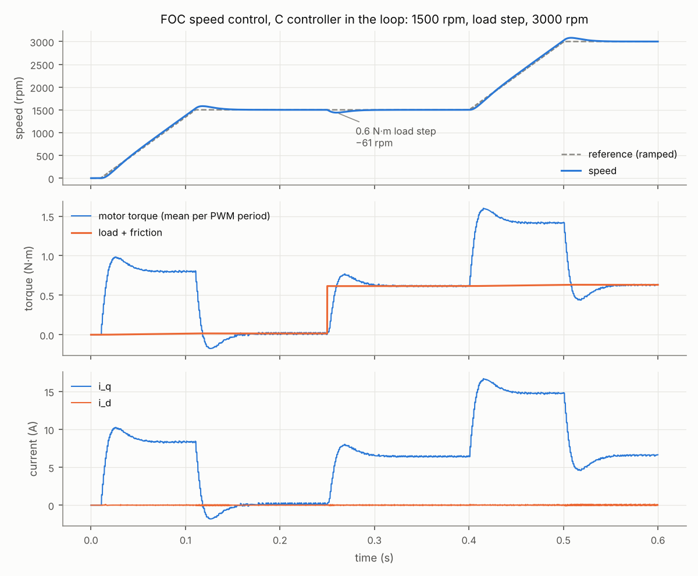
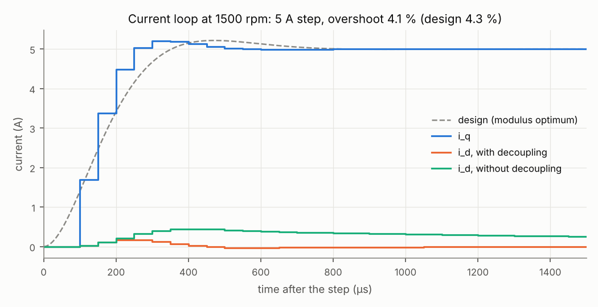
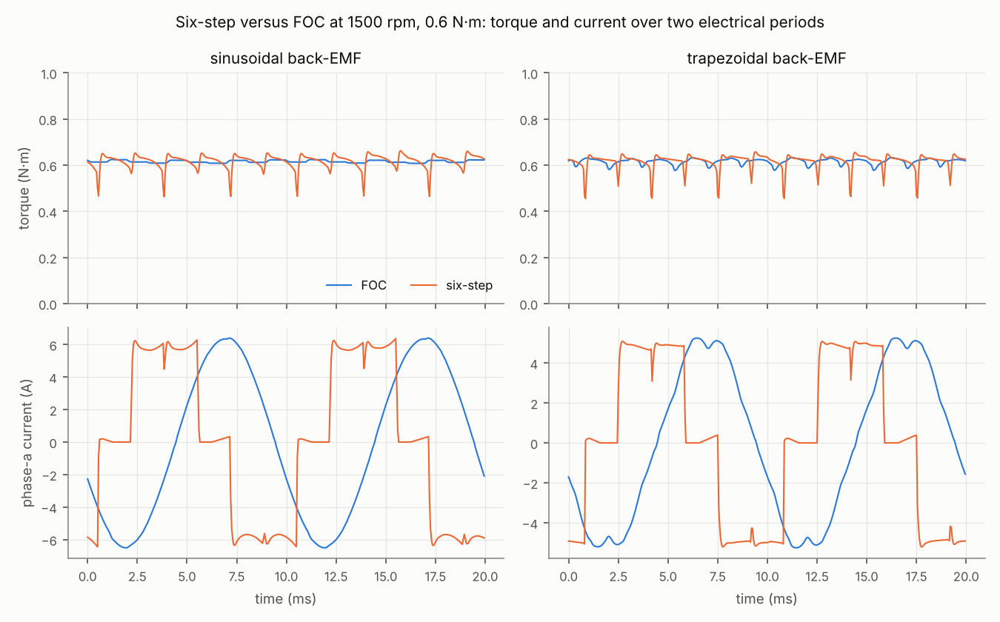
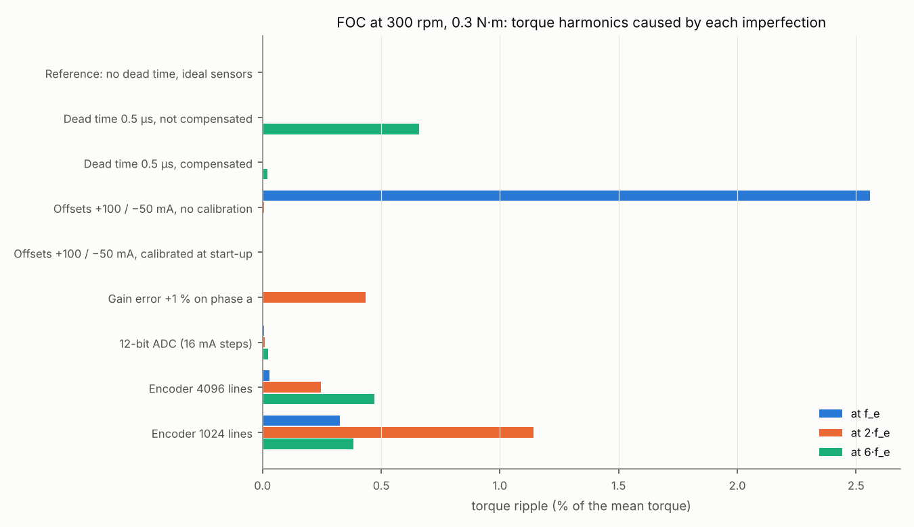
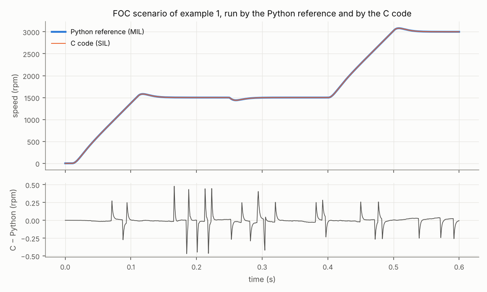

# bldc-control-sim

[](https://github.com/mehdi-belhaj-eea/bldc-control-sim/actions/workflows/ci.yml)

Control of a BLDC / PMSM motor drive, from the model to the embedded code. A Python simulation
of the motor and of the switched inverter (dead time, diodes, sensors) runs the control laws
once per PWM period: field-oriented control (FOC) with an encoder, and six-step control with
Hall sensors. The same laws are written in C99 for a microcontroller, and that C code runs in
the loop against its Python reference (software in the loop). The loops are tuned from the
motor parameters and checked against their design.

> Personal self-training project (2026). The motor and every value are invented, generic
> examples: no data from any employer, customer or program is used.

## What it covers

| Part | Content |
| --- | --- |
| `bldc.motor` | Permanent-magnet motor, sinusoidal or trapezoidal back-EMF, torque, Hall sensors and commutation table |
| `bldc.plant` | Three-phase inverter with center-aligned PWM and dead time, diode conduction and open phases, solved exactly between switching events; averaged model |
| `bldc.sensors` | Current chain (offset, gain error, 12-bit ADC, noise), encoder, Hall sensors |
| `bldc.control` | Clarke/Park, space-vector PWM, PI with anti-windup, loop tuning (modulus and symmetrical optimum), FOC and six-step controllers: the Python reference |
| `c/` | The embedded controller: C99, single-precision float, no dynamic allocation; unit tests; Cortex-M4F build |
| `bldc.csil` | Compiles the C code and runs it in the simulation (ctypes), with a layout check of the interface structures |
| `bldc.analysis` | Torque ripple, harmonics, THD, step-response figures |

The equations and the assumptions are in [docs/methods.md](docs/methods.md).

```
            every PWM period (20 kHz)
 ┌──────────────────────────┐   duties, enables   ┌──────────────────────────────┐
 │ controller               │ ──────────────────► │ inverter + motor + load      │
 │  Python reference  (MIL) │                     │ (switched, dead time, diodes) │
 │  or the C code     (SIL) │ ◄────────────────── │                              │
 └──────────────────────────┘  currents (ADC),    └──────────────────────────────┘
                               angle, Hall code
```

## Worked examples

### 1. FOC speed control, C controller in the loop — [full report](docs/example_foc.md)

| Check | Result |
| --- | --- |
| Current loop, modulus optimum (T_Σ = 1.5·T_s) | crossover 1.06 kHz, 61° margin; 5 A step: 4.1 % overshoot (design 4.3 %) |
| d-q decoupling, same step at 1500 rpm | i_d moves by 0.17 A, against 0.45 A without |
| Speed loop, symmetrical optimum (a = 3) | crossover 25 Hz, 53° margin |
| Current offsets of 100 mA, start-up calibration | residual 3.9 mA (ADC step 16 mA) |
| 0.6 N·m load step at 1500 rpm | 61 rpm dip (linear prediction 62 rpm), back within 1 % in 33 ms |
| Steady state at 1500 rpm, 0.6 N·m | torque ripple 2.8 % peak-to-peak, current THD 0.7 % |

 

### 2. Six-step versus FOC, on a sinusoidal and a trapezoidal motor — [full report](docs/example_six_step_vs_foc.md)

| Motor | Control | Torque ripple (peak-to-peak) | at 6·f_e | Copper loss |
| --- | --- | --- | --- | --- |
| sinusoidal | FOC | 3 % | 0.5 % | 7.4 W |
| sinusoidal | six-step | 33 % | 4.4 % | 8.2 W |
| trapezoidal | FOC | 9 % | 2.3 % | 5.1 W |
| trapezoidal | six-step | 33 % | 3.8 % | 5.7 W |

Six-step needs only three Hall sensors and little computation, but each commutation makes the
torque leave ±10 % of its mean for one to three PWM periods. On a trapezoidal motor block
currents need a lower level than sinusoidal ones (4.9 A against 5.3 A for the same torque), yet
sinusoidal currents still give the lowest copper loss.



### 3. Non-idealities and their signature in the torque — [full report](docs/example_non_idealities.md)

| Imperfection (FOC at 300 rpm) | Torque ripple | Cure |
| --- | --- | --- |
| Dead time 0.5 µs | 0.66 % at 6·f_e | compensation from the sign of the reference current: 0.02 % |
| Current offsets +100 / −50 mA | 2.56 % at f_e | calibration at start-up, legs off |
| Gain error 1 % on one phase | 0.43 % at 2·f_e | gain calibration |
| Encoder 1024 lines (instead of 4096) | 26 % peak-to-peak, broadband | resolution, or a slower / observed speed estimate |



### 4. The C code against its Python reference — [full report](docs/example_back_to_back.md)

| Check | Result |
| --- | --- |
| Same inputs, first 50 ms | duty cycles equal to 3·10⁻⁶ |
| FOC in closed loop, up to 3000 rpm | speeds within 0.5 rpm |
| C unit tests | 971 checks, 0 failures (gcc and clang, warnings as errors) |
| Cortex-M4F, `-Os` | 3.1 kB of code; 184 bytes of state for the FOC controller |



## Use

```bash
pip install -e ".[dev]"
make -C c test            # unit tests of the C controller
pytest                    # Python tests, including the C code against the reference
python examples/foc_speed_control.py
```

```python
from bldc import csil, presets as ps
from bldc.plant import Plant
from bldc.sim import simulate

m = ps.motor("sinusoidal")
plant = Plant(m, v_dc=48.0, f_pwm=20e3, dead_time=0.5e-6, load=lambda t, w: 0.6 if t > 0.25 else 0.0)
ctrl = csil.CFocController(ps.foc_config(m))          # the C code; FocController for the Python one
res = simulate(plant, ctrl, 0.4, lambda t: ps.rpm(1500))
print(res.rpm[-1], res.torque[-200:].mean())
```

On a microcontroller, the C controller runs from the ADC interrupt:

```c
static bldc_foc_t foc;                       /* state: 184 bytes, owned by the application */
if (bldc_foc_init(&foc, &config) != 0) { /* invalid configuration: legs stay off */ }
/* every PWM period, after the current sampling: */
bldc_foc_step(&foc, &inputs, &outputs);     /* duties and enables for the timer */
```

## Limits

- Ideal switches and diodes, linear magnetics (no saturation, no cogging), constant DC link.
- The controllers have no field weakening, no sensorless observer and only basic protections
  (configuration checks, undervoltage lockout, invalid Hall code).
- The six-step speed loop covers 300 to 3000 rpm (designed at 600 rpm, 34° of margin at
  300 rpm): its Hall-based speed estimate gets slower as the speed falls.
- The C code is tested on the host and compiled for a Cortex-M4F; it has not been run on a
  target (processor-in-the-loop) nor on a motor.

## Roadmap

- [x] Motor and inverter model with dead time; FOC and six-step in Python and C; SIL tests (0.1)
- [ ] Sensorless FOC (back-EMF observer and PLL)
- [ ] Field weakening above the base speed
- [ ] Processor-in-the-loop on a Cortex-M4 board, with execution time per period

## About

Mehdi Belhaj, power electronics and embedded systems engineer, Toulouse —
[mehdi-belhaj-eea.github.io](https://mehdi-belhaj-eea.github.io)

I used an AI assistant (Claude) to help write the code and documentation. The equations are
written out in [docs/methods.md](docs/methods.md), and what the tests check is listed at its end.

Licence: MIT.

---

### En bref (français)

Commande d'un moteur BLDC / PMSM, du modèle au code embarqué. Une simulation Python du moteur
et de l'onduleur commuté (temps morts, diodes, capteurs) exécute les lois de commande à chaque
période de MLI : commande vectorielle (FOC) avec codeur et commande six étapes avec capteurs
Hall. Les mêmes lois sont écrites en C99 pour microcontrôleur (float simple précision, sans
allocation dynamique) et ce code C tourne dans la boucle face à sa référence Python
(software-in-the-loop). Réglage des boucles par l'optimum méplat et l'optimum symétrique,
vérifié en simulation ; effets des temps morts, des offsets et du gain des mesures de courant,
et de la résolution du codeur. Quatre exemples complets. Projet personnel d'autoformation ;
toutes les valeurs sont illustratives.
