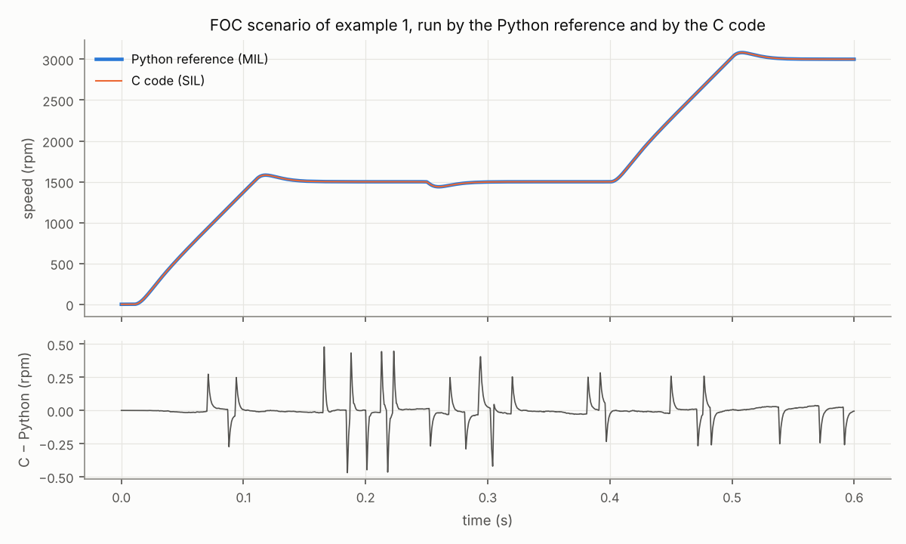

# Example 4 — The C code against its Python reference

The control laws exist twice: in Python (`bldc/control/`), readable and used as the reference, and in C (`c/src/`), as it would be flashed into a microcontroller. The same simulation runs one or the other:

- **MIL**, model in the loop: the Python controller drives the motor model;
- **SIL**, software in the loop: the C code, compiled for this computer, drives the same model.

The next rungs, PIL (the code running on the target processor) and HIL (the real controller board against a real-time motor model), need hardware.

## Back-to-back results

| Comparison | Result |
| --- | --- |
| FOC, scenario of example 1, closed loop: largest speed gap | 0.48 rpm (up to 3000 rpm) |
| Same run: gap on the q current, rms (largest) | 47 mA (308 mA at t = 165 ms) |
| Same run: mean torque at 3000 rpm | 0.003 % apart |
| FOC, same inputs replayed open loop: duty gap over the first 50 ms | 3.2e-06 |
| Same, over the whole 0.6 s | 1.8e-03 |
| Six-step, 1500 rpm, closed loop: largest speed gap | 0.34 rpm |
| C unit tests (`make test`) | 971 checks, 0 failures |

The two are not bit-identical: the C code computes in single precision, as a Cortex-M4F does, and the Python reference in double. On the same inputs the duty cycles agree to 3e-06; replayed without the motor, the small rounding differences on the speed estimate accumulate in the integrators, which a real loop corrects. In closed loop the quantised sensors (ADC codes, encoder counts) turn these differences into slightly different trajectories, a fraction of an rpm apart. The largest current gap falls in the no-load part of the run, where i_q itself fluctuates by about 0.1 A rms (example 3).

## Size on a Cortex-M4F

`arm-none-eabi-gcc -Os -mcpu=cortex-m4 -mfloat-abi=hard -mfpu=fpv4-sp-d16`, objects only and without the layout table used by the Python bindings; the C library functions they call (cosf, fmaxf, fminf, fmodf, memcpy, memset, sinf, sqrtf) come on top.

| Object | Code (bytes) |
| --- | --- |
| bldc_math.o | 594 |
| foc.o | 1410 |
| six_step.o | 1142 |
| **Total** | **3146** |

State in RAM: 184 bytes for the FOC controller, 148 bytes for the six-step controller (no heap, no mutable global data).

