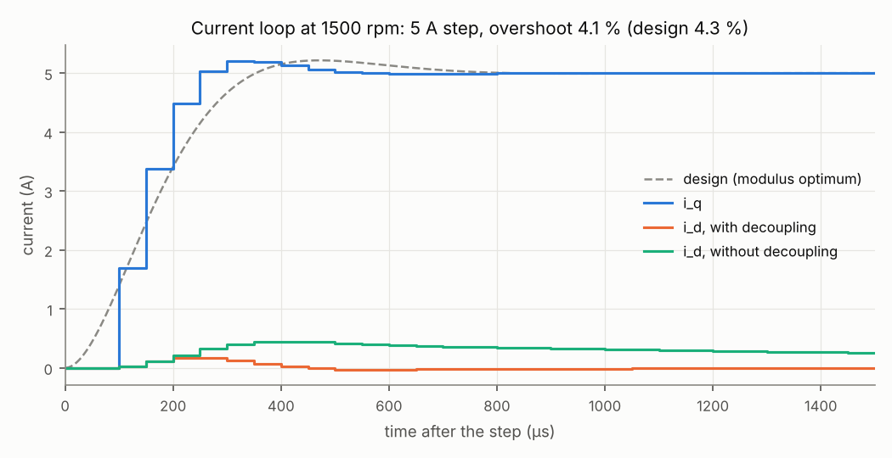
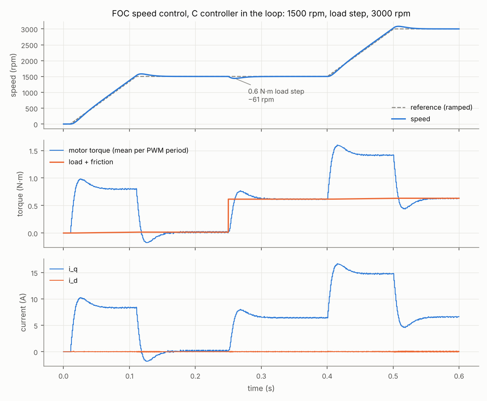

# Example 1 — FOC speed control with the C controller in the loop

Generic 48 V motor (invented values): R = 0.12 Ω, L = 0.25 mH, ψ_m = 16 mWb, 4 pole pairs, J = 5·10⁻⁴ kg·m² with its load. Inverter at 20 kHz, 0.5 µs dead time. The controller is the C code of `c/src/foc.c`, compiled and called once per PWM period.

## Loop design

| Loop | Method | kp | ki | Crossover | Phase margin |
| --- | --- | --- | --- | --- | --- |
| Current (d and q) | Modulus optimum, T_Σ = 1.5·T_s = 75 µs | 1.667 V/A | 800 V/(A·s) | 6667 rad/s (1061 Hz) | 61.4° |
| Speed | Symmetrical optimum, a = 3, T_σ = 2.15 ms | 0.807 A·s/rad | 41.7 A/rad | 155 rad/s (24.7 Hz) | 53.1° |

T_σ of the speed loop: closed current loop (2·T_Σ), speed averaged over the 1 ms speed period and held for the next one (T_ω), first-order speed filter (T_ω again).

## Current loop alone (5 A step on i_q, rotor at 1500 rpm)

| | Overshoot | Time to 90 % | Settling (±2 %) |
| --- | --- | --- | --- |
| Design (continuous model) | 4.3 % | 281 µs | 633 µs |
| Simulation (C code, switched inverter) | 4.1 % | 201 µs | 450 µs |

The overshoot matches. The simulated current starts later and then rises faster: the real delay is a pure delay of one period plus the PWM update, which the design approximates by a first-order lag of 1.5·T_s.

At 1500 rpm the axes are coupled by ω_e·L (a q current induces a d voltage): during the step, i_d moves by 170 mA with the decoupling feed-forward, 448 mA without it.

## Speed control

| Check | Result |
| --- | --- |
| Current offsets +100 / −50 / +20 mA, start-up calibration (10 ms, legs off) | largest residual 3.9 mA (ADC step: 16.1 mA) |
| Overshoot at the end of the ramp to 1500 rpm | 81.3 rpm |
| Mean speed before the load step | 1500.0 rpm |
| Dip after the 0.6 N·m load step | 61 rpm, back within 1 % in 33 ms |
| Torque ripple at 1500 rpm, 0.6 N·m (peak-to-peak / mean) | 2.8 % |
| Torque harmonics at f_e, 2·f_e, 6·f_e | 1.4, 2.2, 3.0 mN·m |
| Phase-current THD at 1500 rpm | 0.7 % (4.54 A rms) |
| Mean speed at 3000 rpm, 0.6 N·m | 3000.6 rpm |
| Voltage used at 3000 rpm | 76 % of the linear limit V_dc/√3 |

The 81 rpm overshoot at the end of the ramp is the price of the symmetrical optimum, tuned for load steps: its integrator keeps the speed on the ramp and carries on when the ramp stops. A filter on the speed reference would remove it.

The remaining torque ripple comes mostly from the speed loop: over the 1 ms speed period the 16384-count encoder gives the speed in steps of 3.7 rpm (0.24 % at 1500 rpm), and the filter and the speed PI turn each step into a step of about 0.15 A of q current (15 mN·m). Example 3 shows how it grows with a coarser encoder.

