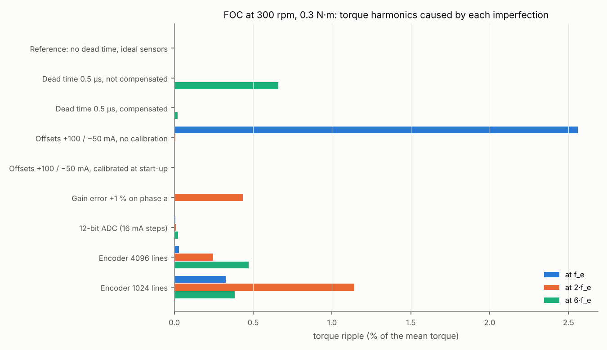
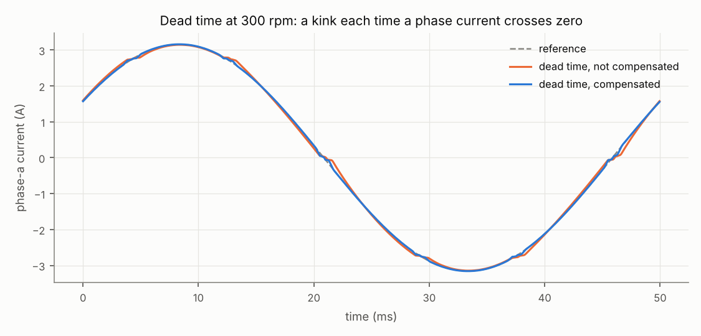

# Example 3 — Non-idealities and their signature in the torque

FOC with the C controller on the sinusoidal motor at 300 rpm (electrical frequency f_e = 20 Hz), 0.3 N·m. Each case adds one imperfection to an ideal drive. Torque harmonics in % of the mean torque, over two electrical periods.

| Case | Ripple (peak-to-peak) | at f_e | at 2·f_e | at 6·f_e | Current THD |
| --- | --- | --- | --- | --- | --- |
| Reference: no dead time, ideal sensors | 0.03 % | 0.00 % | 0.00 % | 0.00 % | 0.00 % |
| Dead time 0.5 µs, not compensated | 1.54 % | 0.00 % | 0.00 % | 0.66 % | 2.70 % |
| Dead time 0.5 µs, compensated | 0.18 % | 0.00 % | 0.00 % | 0.02 % | 0.61 % |
| Offsets +100 / −50 mA, no calibration | 5.40 % | 2.56 % | 0.01 % | 0.00 % | 1.56 % |
| Offsets +100 / −50 mA, calibrated at start-up | 0.03 % | 0.00 % | 0.00 % | 0.00 % | 0.00 % |
| Gain error +1 % on phase a | 0.91 % | 0.00 % | 0.43 % | 0.00 % | 0.12 % |
| 12-bit ADC (16 mA steps) | 0.40 % | 0.01 % | 0.01 % | 0.02 % | 0.05 % |
| Encoder 4096 lines | 5.17 % | 0.03 % | 0.24 % | 0.47 % | 1.34 % |
| Encoder 1024 lines | 26.46 % | 0.33 % | 1.14 % | 0.38 % | 5.75 % |

Each defect leaves its own signature:

- **Dead time**: while both switches of a leg are off, the diode sets the voltage, so each leg loses t_d/T_s·V_dc = 0.48 V against its current: a square-wave error that changes sign with the current. At low speed the motor needs only a few volts, so the error is large in relative terms: 5th and 7th current harmonics, a 6·f_e torque ripple of 0.66 %. The compensation adds back the lost duty according to the sign of the current: 0.02 %. The sign comes from the current reference turned into phase currents, not from the measured current (see below).
- **Current offsets** are a DC error in the stator frame, hence an error at f_e in the rotor frame: 2.56 % of ripple at f_e. Measuring them with the legs off at start-up brings it below 0.01 %; drives do it at every power-up.
- **A gain mismatch** between phases makes the measured current vector elliptical: ripple at 2·f_e (0.43 % for 1 %). It is removed by calibrating the gains, not the offsets.
- **Encoder resolution**: the speed is the angle difference over 1 ms, so it moves in steps of one count; the speed PI turns each step into a step of current. 5 % of peak-to-peak ripple with 4096 lines, 26 % with 1024 lines, spread over all frequencies. The cures: more counts, a longer speed window (more delay), or an observer.

## Dead-time compensation at no load

At 1500 rpm without load the current is small and its PWM ripple (about ±0.3 A) crosses zero every period, so the dead-time error mostly averages out. A compensation driven by the measured current would then act as a negative resistance and amplify the noise; driven by the reference, it only follows the speed-loop noise. Torque ripple with the default sensors:

| Case | Torque peak-to-peak | i_q standard deviation |
| --- | --- | --- |
| No dead time | 16 mN·m | 54 mA |
| Dead time 0.5 µs, not compensated | 16 mN·m | 54 mA |
| Dead time 0.5 µs, compensated | 27 mN·m | 97 mA |

The compensation still costs a little at no load: about 1 % of the rated torque, against the large gain under load at low speed. Drives often fade it out at very light load; the band of ±0.3 A, about half the PWM current ripple, already does part of that.

