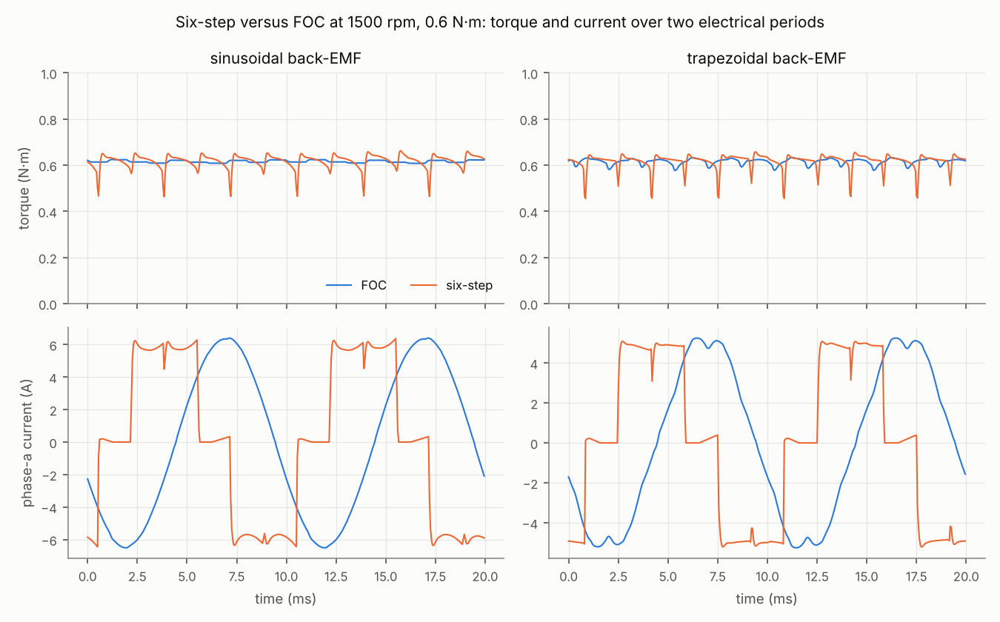

# Example 2 — Six-step versus FOC

Both C controllers at 1500 rpm, fan load 0.6 N·m (plus friction), switched inverter with 0.5 µs dead time, on the same windings with a sinusoidal or a trapezoidal back-EMF (120° flat top). Figures over the last 10 electrical periods; the torque is the mean over each PWM period, its harmonics are in % of the mean torque; the peak current is the instantaneous peak, PWM ripple included.

| Motor | Control | Ripple (peak-to-peak) | at 3·f_e | at 6·f_e | Phase current | Peak current | THD | Copper loss |
| --- | --- | --- | --- | --- | --- | --- | --- | --- |
| sinusoidal | FOC | 3 % | 0.2 % | 0.5 % | 4.54 A rms | 6.8 A | 1 % | 7.4 W |
| sinusoidal | six-step | 33 % | 1.5 % | 4.4 % | 4.78 A rms | 6.9 A | 31 % | 8.2 W |
| trapezoidal | FOC | 9 % | 0.3 % | 2.3 % | 3.76 A rms | 5.6 A | 6 % | 5.1 W |
| trapezoidal | six-step | 33 % | 1.5 % | 3.8 % | 3.97 A rms | 5.8 A | 32 % | 5.7 W |

All runs deliver the same 0.616 N·m. What the table shows:

- **FOC on the sinusoidal motor** is the reference: 3 % of ripple, almost all of it from the speed loop (see example 1).
- **Six-step** draws block currents (32 % THD). At each commutation the outgoing current decays through a diode while the incoming one rises; for 1 to 3 PWM periods the torque leaves ±10 % of its mean. Six commutations per electrical period give the 3.8 % line at 6·f_e (600 Hz here, audible). The current loop regulates the mean of the two conducting currents: regulating the switched one alone would saturate the loop at every other commutation, when the switched phase is the incoming one.
- **On the trapezoidal motor**, block currents need a lower level for the same torque: 4.9 A on the flat tops against a 5.3 A sinusoidal amplitude with FOC (0.128 against 0.117 N·m per ampere of peak). That is the classic argument for six-step: the inverter current rating is used best. But the commutation spikes and the PWM ripple bring the instantaneous peaks level (5.8 A against 5.6 A), and the rms current, so the copper loss, is still lower with FOC (5.1 W against 5.7 W).
- **Six-step on the sinusoidal motor** adds the ripple of the EMF itself: the torque follows the line EMF, which varies by 13 % over each 60° sector, and it costs the most copper loss.
- **FOC on the trapezoidal motor** regulates sinusoidal currents, but the 5th and 7th harmonics of the EMF push harmonic currents through the loop (6 % THD). With perfectly sinusoidal currents this EMF would give 6.0 % of ripple at 6·f_e; the loop's harmonic currents cancel part of it, 2.3 % remains.

In short: six-step when cost and simplicity matter (three Hall sensors, no angle sensor, little computation), ideally on a trapezoidal motor; FOC for smooth torque, low noise and the lowest copper loss, ideally on a sinusoidal motor.

During each six-step sector the phase left off is not always idle: with complementary PWM on the leg that switches, both conducting phases sit at the negative rail during the off-time, so the off phase sees its own EMF at its terminal. While that EMF is negative, its lower diode conducts a small current.

The six-step speed loop is designed at a low speed, 600 rpm, because its speed comes from the Hall edges averaged over one electrical turn: half a turn of delay, 12.5 ms at 600 rpm. It keeps 34° of phase margin at 300 rpm, the bottom of its range, and stays stable up to 3000 rpm (`tests/test_control.py`).

